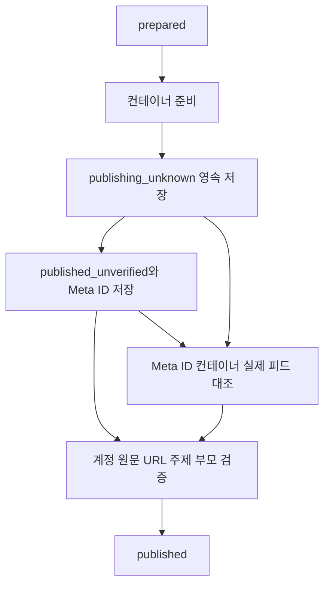

# 2026-11-14 Social Publisher Threads Partial Publishing Incident

보고서 기준일은 2026-11-14 America/Los_Angeles입니다. 작업 키의 날짜와 예약 시각은 Asia/Seoul 기준이며, 아래 API·서버 사건 시각은 UTC로 표시합니다.

## 확인된 근본 원인

네 날짜 모두 두 번째 글은 이미 Meta에 게시돼 실제 permalink가 존재했습니다. 저장된 publish ID와 부모 ID도 맞았으며, 컨테이너 상태는 PUBLISHED였습니다. 인증된 재조회는 HTTP 200을 반환했습니다. 서버의 공개 receipt에서 URL이 null인 것은 Meta가 URL을 만들지 못해서가 아니라 검증 예외 전에 결과를 저장하지 않은 순서 문제였습니다.

승인된 두 번째 글은 모두 `\n\n`으로 시작했습니다. Meta 반환 본문은 이 앞의 LF 두 개만 제거됐습니다. 기존 `text_matches()`는 `.rstrip(" \t\r\n")`만 적용해 앞쪽 LF 제거를 본문 변경으로 오판했습니다. `verify_post()`가 `Published post verification mismatch`를 발생시켰고, `active.result=post`와 다음 Part 실행에 도달하지 못했습니다. 기존 자동 복구도 같은 검사에 걸려 3회 소진했습니다.

10월 26일에 끝부분 공백 오판만 수정하고 앞부분을 그대로 엄격 비교한 것이 이번 재발의 직접적인 코드 원인입니다. 이미지 크기, 부모 글 ID, worker.lock, UID·GID 권한 또는 확인된 Meta 게시 실패가 이번 네 건의 원인이라는 증거는 없습니다.

원래 publish 응답의 HTTP 상태와 정확한 검증 예외 시각은 구버전에서 저장하지 않았습니다. 아래 표의 시각은 확인 가능한 publish_attempt_at이며, 그 값을 검증 예외 발생 시각으로 바꾸어 해석하지 않습니다.

## 작업 ID 재계산과 대조

Python UUID5 규칙은 `uuid.uuid5(uuid.NAMESPACE_URL, "social-publisher/" + dedup_key)`입니다. GitHub 원문과 Oracle DB의 본문 SHA256도 대조했습니다.

| 작업 키 | 기존 작업 ID | Part 수 | 기존 자동 복구 시도 | 원문 Part SHA256 |
|---|---|---:|---:|---|
| morning:2026-11-07 | `04a9d40f-ec90-545c-a2af-6a6ff5e1aa44` | 6 | 3 | `6786f5ee96e310089e55a2fe264f3eb015acca6d1d95ec2b19693094adff73f2` |
| morning:2026-11-12 | `b6aa3682-f834-5779-aa71-8de839fe4e5d` | 6 | 3 | `629abf9e755c59a414e3fc4738ffb6291dc9d95362f50fbca1cadb6c0dcf7345` |
| morning:2026-11-13 | `860bd75a-ed80-5577-a48d-3fd5c4a8af43` | 6 | 3 | `84ceac160b69557f5d833dbdb5fe6836ba566a0239f5bb67bbf5dbcdb1e0ce75` |
| morning:2026-11-14 | `77248b2f-645e-5e45-a88c-20fee31137a4` | 6 | 3 | `bcd71f97c4ff8983992435c6b50a967d299b2ebcbfa50c3525841b91b40a54f8` |

`b6aa3682-f834-5779-aa71-8de839fe4e5d`는 11월 12일 ID입니다. 11월 14일 ID는 `77248b2f-645e-5e45-a88c-20fee31137a4`입니다.

## 복구 전 Part별 실제 상태

`prepared` 글에는 기존 발행 시도나 오류 시각이 없습니다. 두 번째 글의 정확한 검증 예외 시각은 미기록이며, 표에는 마지막으로 저장된 발행 요청 시각을 적었습니다.

| 날짜 | Part | Oracle 상태 | 저장된 Meta ID | 인증된 Meta permalink | 확인된 발행 시도 UTC | 오류 |
|---|---:|---|---|---|---|---|
| 2026-11-07 | 1 | published | 17980930559920349 | https://www.threads.com/@genie_carrot/post/Dfaykb-gUoB | 2026-11-06T23:30:12+00:00 | 없음 |
| 2026-11-07 | 2 | published_unverified | 17924140071451820 | https://www.threads.com/@genie_carrot/post/DfaymPSgXm0 | 2026-11-06T23:30:25+00:00 | 검증기 앞 LF 2개 오판 / 정확한 예외 시각 미기록 |
| 2026-11-07 | 3 | prepared | — | — | — | 미실행 |
| 2026-11-07 | 4 | prepared | — | — | — | 미실행 |
| 2026-11-07 | 5 | prepared | — | — | — | 미실행 |
| 2026-11-07 | 6 | prepared | — | — | — | 미실행 |
| 2026-11-12 | 1 | published | 17915618643558760 | https://www.threads.com/@genie_carrot/post/Dfnqi0hARU9 | 2026-11-11T23:30:11+00:00 | 없음 |
| 2026-11-12 | 2 | published_unverified | 18498451507109004 | https://www.threads.com/@genie_carrot/post/DfnqketAbsw | 2026-11-11T23:30:24+00:00 | 검증기 앞 LF 2개 오판 / 정확한 예외 시각 미기록 |
| 2026-11-12 | 3 | prepared | — | — | — | 미실행 |
| 2026-11-12 | 4 | prepared | — | — | — | 미실행 |
| 2026-11-12 | 5 | prepared | — | — | — | 미실행 |
| 2026-11-12 | 6 | prepared | — | — | — | 미실행 |
| 2026-11-13 | 1 | published | 18438990187199814 | https://www.threads.com/@genie_carrot/post/DfqPVmlgdN6 | 2026-11-12T23:30:11+00:00 | 없음 |
| 2026-11-13 | 2 | published_unverified | 17915624799512045 | https://www.threads.com/@genie_carrot/post/DfqPXVFAY5L | 2026-11-12T23:30:19+00:00 | 검증기 앞 LF 2개 오판 / 정확한 예외 시각 미기록 |
| 2026-11-13 | 3 | prepared | — | — | — | 미실행 |
| 2026-11-13 | 4 | prepared | — | — | — | 미실행 |
| 2026-11-13 | 5 | prepared | — | — | — | 미실행 |
| 2026-11-13 | 6 | prepared | — | — | — | 미실행 |
| 2026-11-14 | 1 | published | 18049110260831859 | https://www.threads.com/@genie_carrot/post/Dfs0IjcgY9q | 2026-11-13T23:30:11+00:00 | 없음 |
| 2026-11-14 | 2 | published_unverified | 17946862575362213 | https://www.threads.com/@genie_carrot/post/Dfs0KKRAS8r | 2026-11-13T23:30:23+00:00 | 검증기 앞 LF 2개 오판 / 정확한 예외 시각 미기록 |
| 2026-11-14 | 3 | prepared | — | — | — | 미실행 |
| 2026-11-14 | 4 | prepared | — | — | — | 미실행 |
| 2026-11-14 | 5 | prepared | — | — | — | 미실행 |
| 2026-11-14 | 6 | prepared | — | — | — | 미실행 |

## GitHub 원본과 Docker 실행본 비교

배포 전 `core.py`, `worker.py`, `recovery.py`, `scheduler.py`, `bridge.py`, `registry.py`를 실제 컨테이너에서 읽었습니다. GitHub recovery.py와 실행본의 SHA256은 모두 `08c53c6b8842d69305e88345202305c155dc106184e91c1eaf2e0c5e63c59254`였고 버전은 `2026-10-26.1`이었습니다.

실행 사용자는 1001:1001이었습니다. /data와 history는 700, DB·토큰·worker.lock·recovery-enabled-at은 600이며 모두 1001:1001 소유였습니다. 과거 10월 24일의 root 소유 marker 문제는 이번 사건에서 재현되지 않았습니다.

## 수정 전후

| 파일 | 변경 내용 |
|---|---|
| `social-publisher/oracle-recovery/recovery.py` | 양끝 ASCII 공백만 비교 시 정규화. 원문·내부 공백·Unicode 문자 보존. 조회된 ID·URL 관측값을 검증 실패 시에도 보존. 인증된 부모 피드로 URL 복원 및 연결 검증. 알려진 영구 오류는 운영자 조치로 분류. |
| `social-publisher/oracle-recovery/durable.py` | fsync와 atomic rename으로 보호된 이력 저장. 매 단계 DB result 체크포인트. 요청별 영구 API 이벤트 테이블. 재시작 시 DB와 더 최신인 이력 파일을 대조. |
| `social-publisher/oracle-recovery/worker.py` | 원래 automation 메타데이터를 최초 체크포인트부터 전달해 작업 ID·dedup_key 추적 유지. |
| `social-publisher/oracle-recovery/test_partial_publishing.py` | 실제 앞 LF 제거와 응답 유실·URL 지연·재시작·중복·429/5xx·이미지·주제·비밀정보 제거 회귀 검사. |
| `social-publisher/oracle-recovery/november/` | 네 원래 작업만 허용하는 계획·배포·복구·상태 검증 스크립트와 원본/수정본 해시 manifest. |

## API 기록과 상태 전이

비공개 `/data/schedule.sqlite3`의 `publisher_api_events`에 작업 ID, dedup_key, Part, 부모·컨테이너·Meta ID, HTTP 상태, 오류 코드, 요청 시작·종료, 단계와 발행 시도 여부를 append-only로 기록합니다. 토큰·Authorization 헤더·원문 전체는 API 이벤트에 넣지 않습니다. Meta 오류 메시지에 토큰이 포함돼도 제거합니다. 요청 시작 기록에 실패하면 외부 요청을 실행하지 않습니다.

`/data/history/<job_id>.json`과 DB result는 진행 단계마다 저장합니다. 각 이력에 checkpoint_seq를 두고, 파일 저장 후 DB 갱신 사이에 프로세스가 중단되면 더 최신 체크포인트를 채택합니다.

Worker 재시작 시 기존 running은 needs_review로 전환되지만 새 버전의 완전한 체크포인트가 있으면 같은 ID로 대조·재개합니다. 이미 게시한 Part는 건너뜁니다. 미확인 발행 요청은 새 컨테이너나 새 키로 우회하지 않습니다. 자동 복구는 최대 3회이며 backoff를 적용합니다. 다른 구버전의 과거 실패 작업은 이번 배포로 임의 재개하지 않습니다.

## 과거 부분 게시 복구와 만료 처리

이번 네 작업은 예약 기한이 지났어도 이미 수신돼 첫 두 글이 게시된 부분 작업입니다. 현재 사용자의 명시적 기존 작업 복구 요청에 따라, 그 네 ID만 허용하고 원문·이미지·주제·due·expires_at을 변경하지 않습니다. 기존 Root와 두 번째 글을 재검증하고 prepared였던 3~6번만 이어 게시합니다. 시작되지 않은 expired/missed 작업을 새 ID로 발행하지 않습니다.

## 테스트와 실제 배포

로컬 및 GitHub Actions에서 29개 테스트를 실행했습니다. 필수 시나리오 8개는 모두 Mock API로 재현했습니다. 별도의 공개 테스트 글은 만들지 않았습니다. 네 기존 연결 글의 남은 16개 Part를 복구하는 실증 검증을 수행했습니다.

| 필수 시나리오 | 회귀 검증 |
|---|---|
| 6개 연결 글 전체 성공 | 앞 LF가 있는 6개 Part 원문 보존 및 6회 발행 |
| 두 번째 글 응답 유실 | 실제 수락 후 timeout을 재현하고 같은 ID 채택·재게시 없음 |
| 게시됐으나 URL 누락 | 부모 피드의 동일 Meta ID에서 permalink 복원 또는 ID 보존 후 재조회 |
| 세 번째 직전 Worker 재시작 | SystemExit 후 DB/이력 복원, 기존 2개 건너뛰고 완료 |
| 동일 dedup_key 재유입 | 실제 Bridge.ingest 동작으로 단일 DB 행 유지·변경 원문 거절 |
| 429/5xx | GET backoff와 발행 응답 대조, 불명확한 POST 재전송 없음 |
| 이미지 정상 및 오류 | 실제 이미지 메타데이터 일치 검사, 해시 오류는 컨테이너/발행 전 차단 |
| 공식 주제 검증 | 실제 root topic_tag 일치·불일치 차단 |

배포 스크립트는 실행 중/임박한 작업을 점검하고 정상 종료 후 SQLite 일관 백업·history·컨테이너 설정을 보호된 디렉터리에 저장합니다. 기존 실행 이미지 위에 recovery.py·worker.py·durable.py만 복사한 이미지를 빌드하고 사용자·환경·마운트·제한·재시작 정책을 보존합니다. 토큰·키를 GitHub에 넣지 않습니다.

새 버전은 `2026-11-14.1`입니다. 실행 Docker 이미지와 GitHub 파일 해시는 manifest와 다시 대조합니다.

## 장애 대응과 롤백

1. 먼저 fresh receipt와 해당 ID의 비공개 result/history/API 이벤트를 대조합니다. permalink 누락만으로 미게시로 판단하지 않습니다.
2. 기존 키·원문·주제·이미지·일정을 바꾸지 않습니다. 실제 ID가 있으면 그 게시물과 부모 피드부터 조회합니다.
3. 알려진 영구 인증/정책/본문·주제 불일치이면 재시도 대신 operator_required와 구체적 이유를 기록합니다.
4. 배포 전 진행 중 작업이 있으면 보류합니다. worker.lock을 점유한 다른 작업자와 동시에 수동 복구하지 않습니다.
5. 새 컨테이너가 실행되지 않으면 보존한 이전 컨테이너로 실행 코드만 되돌립니다. 이미 게시된 결과가 DB에 있으므로 과거 DB를 복원하지 않습니다.
6. 새 작업자가 이미 실행 중인 상태에서 건강 확인만 실패하면 임의 강제 종료하지 않습니다. 현재 진행과 잠금을 진단한 뒤 정상 종료·코드 롤백을 수행합니다.
7. 10월 날짜에 고정된 복구 스크립트를 새 사건에 재사용하지 않습니다. `november/plan.json`은 이번 네 원래 작업만 허용합니다.

운영자가 사용할 진입점은 GitHub Actions `repair-threads-partial-20261114.yml`입니다. 기본 verify는 추가 발행 없는 상태 확인이며, 명시적 deploy만 백업·배포·이 사건의 같은 ID 복구를 수행합니다. CI 회귀 테스트는 서버 자격증명 없이 실행합니다.

## 실제 배포 및 복구 결과

실제 배포 후 첫 Health Check는 시작 직후 GitHub 설정 조회 HTTP 500 때문에 60초 안에 끝나지 않았습니다. 이미 실행 중인 작업자를 강제 롤백하거나 control을 바꾸지 않고, 기존 180초 조회 주기의 정상 회복을 확인했습니다. Health Check 허용 시간은 420초로 보완했습니다. 최종 별도 검증 실행은 성공했습니다.

| 항목 | 실제 결과 |
|---|---|
| 배포 버전 | `2026-11-14.1` |
| 최종 검증 실행 | https://github.com/comfunnylj/telegram-market-feed/actions/runs/43621700214 |
| 코드 커밋 | https://github.com/comfunnylj/telegram-market-feed/commit/e0214a13c6090af23a63d58a1ba0b9895be2ab41 |
| 서버 배포 | deployed_verified |
| 다른 작업 보존 | `{"other_jobs_unchanged": true, "environment_unchanged": true, "user_unchanged": true, "restart_policy_unchanged": true, "command_unchanged": true}` |
| Health Check | `healthy` |

### morning:2026-11-07

원래 작업 ID `04a9d40f-ec90-545c-a2af-6a6ff5e1aa44`. Root 유지 `True`, 두 번째 글 유지 `True`. 최종 `published`.

| Part | Meta ID | 실제 permalink | 최종 상태 | 공식 주제 | 검증 시각 UTC |
|---:|---|---|---|---|---|
| 1 | 17980930559920349 | https://www.threads.com/@genie_carrot/post/Dfaykb-gUoB | published | 미국주식 | 2026-11-14T17:33:56+00:00 |
| 2 | 17924140071451820 | https://www.threads.com/@genie_carrot/post/DfaymPSgXm0 | published | 답글에는 미설정 | 2026-11-14T17:33:57+00:00 |
| 3 | 18447883228133890 | https://www.threads.com/@genie_carrot/post/Dfuu_7LAbLP | published | 답글에는 미설정 | 2026-11-14T17:33:58+00:00 |
| 4 | 17981151143925267 | https://www.threads.com/@genie_carrot/post/DfuvB-cAacf | published | 답글에는 미설정 | 2026-11-14T17:33:59+00:00 |
| 5 | 18156013408544702 | https://www.threads.com/@genie_carrot/post/DfuvES0gTmD | published | 답글에는 미설정 | 2026-11-14T17:34:00+00:00 |
| 6 | 18115238243612669 | https://www.threads.com/@genie_carrot/post/DfuvFgogUVg | published | 답글에는 미설정 | 2026-11-14T17:34:01+00:00 |

### morning:2026-11-12

원래 작업 ID `b6aa3682-f834-5779-aa71-8de839fe4e5d`. Root 유지 `True`, 두 번째 글 유지 `True`. 최종 `published`.

| Part | Meta ID | 실제 permalink | 최종 상태 | 공식 주제 | 검증 시각 UTC |
|---:|---|---|---|---|---|
| 1 | 17915618643558760 | https://www.threads.com/@genie_carrot/post/Dfnqi0hARU9 | published | 미국주식 | 2026-11-14T17:34:08+00:00 |
| 2 | 18498451507109004 | https://www.threads.com/@genie_carrot/post/DfnqketAbsw | published | 답글에는 미설정 | 2026-11-14T17:34:09+00:00 |
| 3 | 18111418613625771 | https://www.threads.com/@genie_carrot/post/DfuvKAUgdyU | published | 답글에는 미설정 | 2026-11-14T17:34:10+00:00 |
| 4 | 17890207056485173 | https://www.threads.com/@genie_carrot/post/DfuvMBeAbHv | published | 답글에는 미설정 | 2026-11-14T17:34:11+00:00 |
| 5 | 17991555579095772 | https://www.threads.com/@genie_carrot/post/DfuvNMnAaC6 | published | 답글에는 미설정 | 2026-11-14T17:34:12+00:00 |
| 6 | 18131242799489148 | https://www.threads.com/@genie_carrot/post/DfuvPI_gVpc | published | 답글에는 미설정 | 2026-11-14T17:34:14+00:00 |

### morning:2026-11-13

원래 작업 ID `860bd75a-ed80-5577-a48d-3fd5c4a8af43`. Root 유지 `True`, 두 번째 글 유지 `True`. 최종 `published`.

| Part | Meta ID | 실제 permalink | 최종 상태 | 공식 주제 | 검증 시각 UTC |
|---:|---|---|---|---|---|
| 1 | 18438990187199814 | https://www.threads.com/@genie_carrot/post/DfqPVmlgdN6 | published | 미국주식 | 2026-11-14T17:34:20+00:00 |
| 2 | 17915624799512045 | https://www.threads.com/@genie_carrot/post/DfqPXVFAY5L | published | 답글에는 미설정 | 2026-11-14T17:34:21+00:00 |
| 3 | 18026556428946528 | https://www.threads.com/@genie_carrot/post/DfuvV96gYOe | published | 답글에는 미설정 | 2026-11-14T17:34:22+00:00 |
| 4 | 18000280311043094 | https://www.threads.com/@genie_carrot/post/DfuvXPuAS8G | published | 답글에는 미설정 | 2026-11-14T17:34:23+00:00 |
| 5 | 18385222039237991 | https://www.threads.com/@genie_carrot/post/DfuvZEOgZ13 | published | 답글에는 미설정 | 2026-11-14T17:34:24+00:00 |
| 6 | 17928220656441024 | https://www.threads.com/@genie_carrot/post/Dfuva9ngRr8 | published | 답글에는 미설정 | 2026-11-14T17:34:25+00:00 |

### morning:2026-11-14

원래 작업 ID `77248b2f-645e-5e45-a88c-20fee31137a4`. Root 유지 `True`, 두 번째 글 유지 `True`. 최종 `published`.

| Part | Meta ID | 실제 permalink | 최종 상태 | 공식 주제 | 검증 시각 UTC |
|---:|---|---|---|---|---|
| 1 | 18049110260831859 | https://www.threads.com/@genie_carrot/post/Dfs0IjcgY9q | published | 미국주식 | 2026-11-14T17:34:31+00:00 |
| 2 | 17946862575362213 | https://www.threads.com/@genie_carrot/post/Dfs0KKRAS8r | published | 답글에는 미설정 | 2026-11-14T17:34:31+00:00 |
| 3 | 17912755857588728 | https://www.threads.com/@genie_carrot/post/DfuvfH-gWI2 | published | 답글에는 미설정 | 2026-11-14T17:34:33+00:00 |
| 4 | 18118649591042343 | https://www.threads.com/@genie_carrot/post/DfuvgV4gTdR | published | 답글에는 미설정 | 2026-11-14T17:34:34+00:00 |
| 5 | 18403013314206922 | https://www.threads.com/@genie_carrot/post/Dfuvhsjgc5a | published | 답글에는 미설정 | 2026-11-14T17:34:35+00:00 |
| 6 | 17981840799140604 | https://www.threads.com/@genie_carrot/post/DfuvjCGAcWu | published | 답글에는 미설정 | 2026-11-14T17:34:36+00:00 |

## 보존 범위와 남은 관찰

비공개 API 이벤트 208개가 저장됐으며, 발행 요청은 각 작업의 Part 3~6에만 각각 한 번씩 총 16회입니다. 이 16회 발행 응답은 모두 HTTP 200입니다. 기존 Part 1~2 발행 요청은 0회입니다. 네 Root·두 번째 글의 원래 ID가 유지됐고, 각 위치의 원문을 부모 피드에서 유일하게 확인해 이번 복구의 중복이 없음을 검증했습니다. 다른 74개 작업의 DB 행과 실행 환경·사용자·재시작 정책·실행 명령은 배포 전 백업과 일치합니다.

ChatGPT 자동화 일정, control.enabled, tasks.json 활성 상태, 타 source outbox, 기존 dedup_key·원문·이미지·공식 Topic Tag, 타 SNS 경로는 변경하지 않았습니다. 배포 전후 다른 작업의 DB 행도 비교합니다.

현재 관측은 인증된 Meta API·서버 DB·receipt·로그 기준입니다. 향후 아직 실행되지 않은 정기 발행까지 성공했다고 미리 보고하지 않습니다. 신규 Root부터 6개 Part 전체 처리는 회귀 테스트로 검증했고, 실계정 검증은 승인된 네 과거 작업의 전체 24개 Part 복구로 수행했습니다.

## 근거와 보관 위치

- 읽기 전용 실제 진단: https://github.com/comfunnylj/telegram-market-feed/actions/runs/43619604638
- 실제 배포 실행: https://github.com/comfunnylj/telegram-market-feed/actions/runs/43620813263
- 성공한 최종 서버 검증: https://github.com/comfunnylj/telegram-market-feed/actions/runs/43621700214
- 성공한 독립 회귀 CI: https://github.com/comfunnylj/telegram-market-feed/actions/runs/43621700216
- 기존 10월 26일 기록: https://github.com/comfunnylj/telegram-market-feed/blob/main/social-publisher/diagnostics/2026-10-26-morning-verification-incident.md
- 운영 규약: https://github.com/comfunnylj/telegram-market-feed/blob/main/social-publisher/AUTOMATION.md
- Google Drive 보관 폴더: 프로젝트 / Skill & Manual
- 이 보고서: social-publisher/diagnostics/2026-11-14_Social-Publisher_Threads-Partial-Publishing_Incident.md
